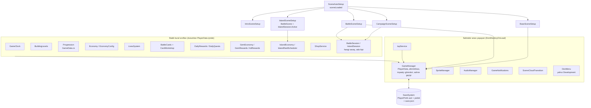
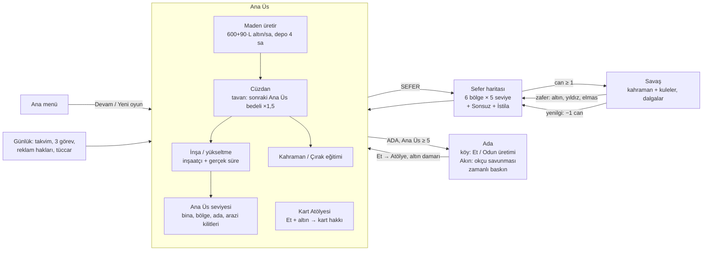
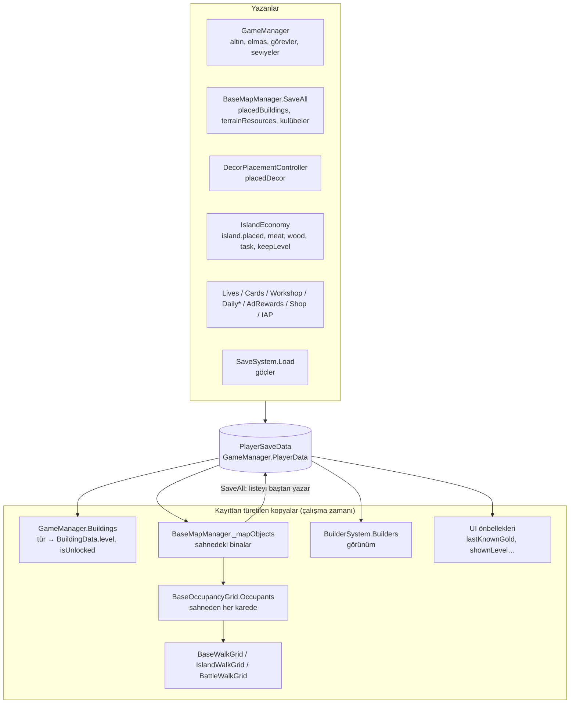
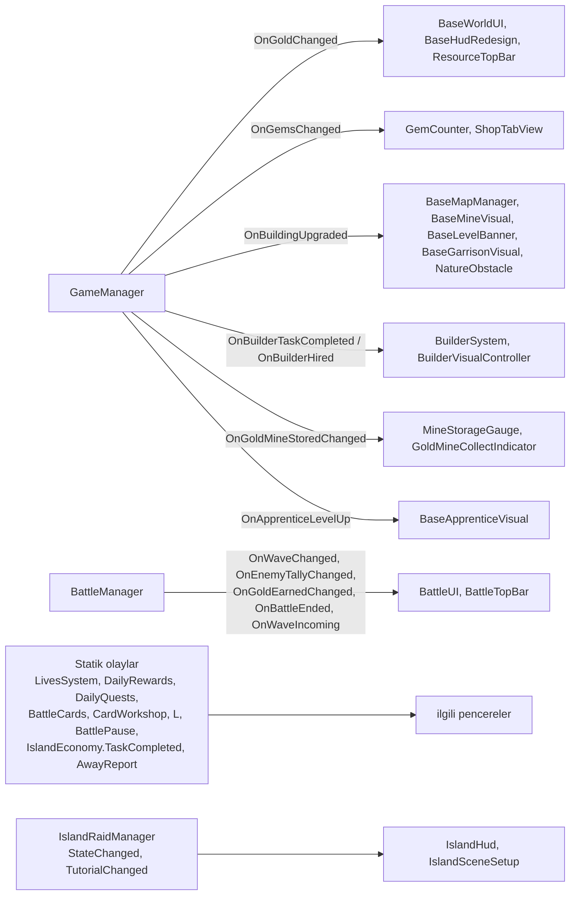

# ARCHITECTURE — Mini Empire Builder

Durum: 15 Kasım 2026, dal `gece-gelistirme`, başlangıç commit'i `cbee273`. Bu belge kodun **bugünkü** hâlini anlatır (9. oturum denetimi).
Sorunlar ve çözümler `TECH_AUDIT.md` içindedir; oturum geçmişi `Docs/AI_README.md`, kararlar `DECISIONS.md`.

## 1. Genel bakış

| Konu | Değer |
|---|---|
| Motor | Unity 6000.3.9f1, URP 2D 17.3.0, IL2CPP, yalnız ARM64, dikey |
| Kod | `Assets/Scripts`: 239 dosya, 59.300 satır. Editör araçları 14 dosya / 2.272 satır. Testler 66 dosya / 18.075 satır (PlayMode) |
| Derleme birimleri | Tek `Assembly-CSharp` (oyun kodunda asmdef yok). Testler `BasePresentationTests` asmdef'inde ve oyun koduna **yansıma** ile erişir |
| Sahneler | `MainMenuScene`, `BaseScene`, `BattleScene`, `CampaignScene`. Ada (Martı Adası) ayrı sahne değildir: `BattleScene` ada kipinde kurulur |
| Sahne içeriği | Sahneler neredeyse boştur; her şey kodla kurulur (`SceneAutoSetup` → `*SceneSetup`) |
| Kayıt | Tek `PlayerSaveData` nesnesi → JSON → PlayerPrefs (asıl + yedek) + `persistentDataPath/save.json`. Sürüm 13 |
| Paketler | Input System 1.18, Unity IAP 5.4.0, Mobile Notifications 2.4.2, DOTween (Plugins), TextMesh Pro |
| Üçüncü taraf SDK | Reklam: **yok** (3 sn'lik deneme ekranı). Analitik: yok. Çökme raporu: yok. Bulut kaydı: yok. Ağ çağrısı: yok (IAP hariç) |
| Yerel kütüphane | Projede `.aar/.so/.framework` yok; yalnız Unity'nin kendi kütüphaneleri |

### Klasörler (`Assets/Scripts`)

| Klasör | Dosya / satır | Sorumluluk |
|---|---|---|
| `Managers` | 7 / 2.713 | `GameManager` (kalıcı tekil nesne: kayıt, altın/elmas, inşaatçı görevleri, sahne geçişi), `SceneAutoSetup`, `SpriteManager`, bulut geçişi |
| `Data` | 6 / 2.731 | `PlayerSaveData` + `SaveSystem`, `GameData` (`Progression`: bütün seviye/bedel/kilit formülleri), `EconomyConfig`, `FeatureConfig`, `TimingConfig`, `CampaignEnemyConfig` |
| `Systems` | 30 / 4.561 | Oyun kuralları (statik sınıflar): `GameClock`, `BuildingLevels`, `LivesSystem`, `BattleCards`, `CardWorkshop`, `DailyRewards`, `DailyQuests`, `GemEconomy`, `GemRewards`, `AdRewards`, `RewardedAds`, `SpecialModes`, `GameNotifications`, `GridPathfinding`, `Shop/*`, `L` (dil), geliştirici araçları (`DevSettings`, `PlaytestBot`, `PlaytestJourney`) |
| `Base` | 43 / 11.342 | Ana Üs sahnesi: `BaseSceneSetup`, `BaseMapManager`, `BaseOccupancyGrid`, `BaseWalkGrid`, `PlacementController`, `DecorPlacementController`, `BuilderSystem`, `LandExpansion`, görseller |
| `Battle` | 37 / 10.422 | Savaş: `BattleManager`, `EnemyController`, `HeroController`, `TowerController`, `BattleStructure`, bölge mekanikleri, boss'lar, `Map/*` (bölge haritaları) |
| `Island` | 43 / 12.661 | Ada: `IslandSceneSetup`, `IslandEconomy`, `IslandVillage`, `IslandGrid`, `IslandRaidManager`, `IslandRaidScheduler`, `IslandHud`, öğretici/tanıtım |
| `Campaign` | 3 / 1.345 | Sefer haritası, `BattleSession` (hangi bölge/seviye), `RegionData` |
| `UI` | 31 / 6.845 | Pencereler: `BaseWorldUI`, `RadialDockMenu`, `ShopTabView`, `GemConfirm`, `DevMenu`, `SelectionManager` |
| `Polish` | 37 / 5.417 | HUD kaplamaları (`BaseHudRedesign`, `BattleTopBar`), ses (`AudioManager`), efektler |
| `Intro` | 1 / 1.203 | Ana menü |

En büyük sınıflar: `BaseMapManager` 1.938, `BaseSceneSetup` 1.742, `BattleManager` 1.430, `GameData` 1.306, `EnemyController` 1.254,
`IslandHud` 1.222, `IntroSceneSetup` 1.203, `GameManager` 1.165, `CampaignSceneSetup` 1.126.

### Uygulama boyutu girdileri
- `Assets` 643 MB; bunun ~480 MB'ı üçüncü taraf paket (çoğu derlemeye girmez).
- Derlemeye **kesin giren**: `Assets/Resources` 48 MB (png/jpg 41,75 MB) + TMP Resources 2,2 MB + sahnelerin başvurduğu varlıklar.
- Müzik: 12 dosya, 115 MB kaynak (Vorbis, akış). Son AAB: 92,6 MB (PLAY_RELEASE §5).

## 2. Çalışma zamanı yapısı

**Bağımlılık biçimi:** servis bulucu yok; her şey `GameManager.Instance` ve statik sınıflar üzerinden. Sahne nesneleri birbirini
`FindFirstObjectByType` / `GameObject.Find` ile bulur (kodda 278 kullanım, 87 dosya). Sahne içi tekiller (`BaseMapManager.Instance`,
`BattleManager.Instance`, `IslandVillage.Instance`…) sahneyle birlikte ölür.

## 3. Ana döngüler

| Döngü | Giriş noktası | Kural sınıfları | Kayıt alanları |
|---|---|---|---|
| Ana Üs ekonomisi | `BaseSceneSetup`, `PlayerController` (çevrimiçi maden üretimi + 10 sn'de bir kayıt) | `Economy.Active`, `Progression`, `GameManager` | `gold`, `goldMineStoredGold`, `goldMineLastCollectTime`, `placedBuildings`, `builderTasks` |
| İnşa / yükseltme | `BuildMenuController`, `PlacementController`, `BaseWorldUI` | `GameManager.StartBuilderTask/CheckBuilderTask`, `BuildingLevels` | `builderTasks`, `placedBuildings[].level`, `buildings[]` |
| Sefer | `CampaignSceneSetup` → `BattleSession.Begin` → `GameManager.TryStartCampaignBattle` | `LivesSystem`, `BattleCards`, `CampaignCatalog`, `CampaignEnemyConfig` | `campaignProgress`, `lives`, `workshop.stock` |
| Savaş | `BattleSceneSetup` → `BattleManager` | `EnemyController` (yol durum makinesi), `BattleStructure`, `BattleWalkGrid`, `BattlePause` | Savaş sırasında kayıt yok; sonuç `BattleWon/BattleLost` ile yazılır |
| Ada | `IslandSceneSetup` → `IslandVillage`, `IslandHud` | `IslandEconomy`, `IslandGrid`, `IslandRaidScheduler` | `island.*` (aynı kayıt nesnesinin alt nesnesi) |
| Akın (ada savunması) | `IslandRaidBoard` → `IslandRaidManager` | `IslandWaves`, `IslandArcher`, `IslandAbilities` | `island.highestAkin`, ödüller cüzdana |
| Kart Atölyesi | `CardWorkshopPanel` | `CardWorkshop` (`GameManager.Update` içinde `TickIfAny`) | `workshop.queue`, `workshop.stock` |
| Görevler / takvim | `DailyQuestsUI`, `DailyRewardsUI` | `DailyQuests`, `DailyRewards`, `GameClock.TodayId` | `quest*`, `daily*` |
| Dükkân | `ShopTabView`, `GemShopUI` | `ShopService` (elmas → kaynak), `IapService` (para → elmas) | `gems`, `iapLedger` |

## 4. Durum verisi haritası

Bütün kalıcı durum **tek nesnededir**: `GameManager.Instance.PlayerData` (`Assets/Scripts/Managers/GameManager.cs:17`). Ada verisi
(`PlayerData.island`) aynı nesnenin parçasıdır; `IslandSession.Save` kopya değil, başvurudur. Kayıt yalnız `GameManager.SaveGame()` üzerinden yazılır.

### 4.1 Veri → tek doğru kaynak tablosu

| Veri | Kaynak (kayıt) | Türetilen / ikinci kopya | Kim yazar | Not |
|---|---|---|---|---|
| Altın | `gold` | UI: `BaseWorldUI.lastKnownGold`, `BattleUI.displayedGold` | `GameManager.AddGold/SpendGold/CollectGoldFromMineStorage` | Olay: `OnGoldChanged`. Tavan `GetMaxGoldCapacity` |
| Maden deposu | `goldMineStoredGold`, `goldMineLastCollectTime` | `PlayerController.mineAccumulator` (kesir) | `GameManager`, `PlayerController` | İki ayrı saat kullanılıyordu (bkz. TECH_AUDIT K-2) |
| Elmas | `gems` | — | `GameManager.AddGems/SpendGems` | `OnGemsChanged`; tavan 999.999 |
| Et / Odun | `island.meat`, `island.wood` | — | `IslandEconomy`, `IslandNatureClear`, `IslandSession` | **Değişim olayı yok**; üst bar yoklamayla okur |
| Bina seviyesi | `placedBuildings[].level` (tamamlanmış seviye) | `buildings[].level` (türün en yükseği, **kayıtta ikinci kopya**), `GameManager.Buildings[type].level`, `BaseBuildingVisual.currentLevel` | `GameManager.ApplyInstanceUpgrade` → `RecomputeTypeLevel` | Tamamlanmış seviye okuması `BuildingLevels` üzerinden |
| Ana Üs seviyesi | Ana Üs binasının `placedBuildings[].level` değeri | `buildings[MainBase].level`, `Buildings[MainBase].level` | aynı | `GetMainBaseLevel()` çalışma zamanı kopyasını okur |
| Bina kilidi | `buildings[].isUnlocked` (**kayıtlı türetilmiş değer**) | `Buildings[type].isUnlocked` | `CheckUnlockBuildings` (yalnız Ana Üs yükselince) | Kural: `Progression.FirstUnlockLevel` |
| Kahraman / Çırak seviyesi | `hero.level`, `apprenticeLevel` | `HeroController.heroLevel` (savaş), görseller | `GameManager.CompleteHeroUpgrade/CompleteApprenticeUpgrade` | Tavan = Ana Üs seviyesi |
| İnşaatçı görevleri | `builderTasks` (UTC tick) | `BuilderSystem.Builders` (görünüm), `BuilderTaskMarker` | `GameManager.StartBuilderTask/CheckBuilderTask` | Oyun kapalıyken ilerler |
| Ana Üs doluluğu | **Sahne** (canlı nesneler) | `BaseOccupancyGrid.Occupants` (her karede sıfırdan), `BaseWalkGrid` (0,25 sn imza denetimi) | `BaseMapManager`, `DecorPlacementController`, `NatureObstacle` | 8. oturumda tek kaynağa indirildi (D100) |
| Ana Üs yerleşimi | `placedBuildings[].x/y`, `placedDecor`, `builderHuts`, `terrainResources`, `removedNatureIds`, `landOpened` | `BaseMapManager._mapObjects` | `BaseMapManager.SaveAll` (listeyi sahneden baştan yazar) | Yükleme onarımı sahne açılınca çalışır |
| Ada yerleşimi | `island.placed`, `clearedTrees`, `clearedNature`, `zoneMask` | `IslandGrid` statik maskeleri, `IslandWalkGrid` | `IslandEconomy`, `IslandBuildings` | Akın canlı kaydı okur (anlık görüntü yok) |
| Ada seviyeleri | `island.keepLevel`, `archerLevel`, `placed[].level` | `IslandBot.KeepLevel`, `IslandArcher.KeepLevel` (akın başında kopya) | `IslandEconomy` | v13'ten beri Ana Üs'ten bağımsız |
| Zamanlayıcılar | `builderTasks`, `island.task`, `workshop.queue`, `livesLastRegenTicks`, `mineBoostUntilTicks`, `buildPotionUntilTicks`, `tempBuilderUntilTicks`, `royalUntilTicks`, `island.nextRaidTicks`, `terrainLastGrowTicks` | — | ilgili sistem | Saat: `GameClock.UtcNow` (kayıttaki `clockHighWaterTicks` ile geri alınamaz) |
| Günlük sayaçlar | `ad*Day/Count`, `quest*`, `daily*`, `traderDay`, `lumberShipDay`, `island.replayDay` | — | `AdRewards`, `DailyQuests`, `DailyRewards`, `IslandEconomy` | Hepsi kayıtta; PlayerPrefs'te ekonomi verisi yok |
| Kilit kuralları | — (kural, veri değil) | `Progression.*` (bina, bölge, inşaatçı, ada, atölye), `LandExpansion.RequiredMainBase`, `RegionData.requiredBaseLevel`, `SpecialModes.RequiredBaseLevel` | — | Ada kilidi iki sabitte: `Progression.Island.UnlockMainBaseLevel` ve `SpecialModes.RequiredBaseLevel` (ikisi de 5) |
| Öğretici bayrakları | `firstBaseGuideDone`, `firstBattleTowerBuilt`, `island.introSeen`, `island.buildTutorial`, `island.tutorialStep`, `island.nameOffered`, `island.announced`, `workshop.firstFreeUsed` | PlayerPrefs: ipucu bayrakları (`MiniEmpireBuilder_Tip_*`, `MoveHintSeen`, `MEB_PostHintShown`) | ilgili öğretici | İlerlemeyi etkileyenler kayıtta, yalnız görsel ipuçları PlayerPrefs'te |
| Rozetler | — (durum tutulmaz) | `BaseBadges.CanBuildNew`, `RadialDockMenu.RefreshBadges` 0,5 sn'de bir kuraldan hesaplar | — | Olay değil yoklama: takılı rozet oluşamaz |
| Ayarlar | PlayerPrefs (ses, dil, titreşim, bildirim, menü durumu) | — | ilgili UI | Kayıt dışı, ilerlemeyi etkilemez |
| Bekleyen sahte satın alma | PlayerPrefs `MEB_FakeIap_Pending` | — | `FakeStoreBackend` | Yalnız editör/test mağazası |

### 4.2 Kayıt biçimi ve sürümler
- `PlayerSaveData.CurrentVersion = 13`. Göç zinciri v2…v13, `SaveSystem.Load` içinde.
- Sürüm numarası dışında izlenen düzen sürümleri: `decorLayoutVersion`, `timingVersion`, `landOpened = −1` (eski kayıt işareti),
  `natureBaselineLevel`, `island.levelsIndependent`, `island.legacyVillage`, `island.villageSeeded`.
- Sahneye bağlı onarımlar (kayıt yüklenirken değil, **sahne açılınca** çalışır): `BaseMapManager.RepairVisualLayout / ValidateOccupancy`,
  `DecorPlacementController` 1×1 göçü, `IslandRepair.CleanGhosts`, `IslandEconomy.EnsureStarted`, `LandExpansion.OpenedTier`.

## 5. Olaylar

- `GameManager` olaylarına abone olan sınıfların hepsi `OnDestroy`'da aboneliği bırakıyor (doğrulandı: 14 sınıf).
- Statik olaylara abonelikler eşli (`OnEnable/OnDisable` ya da `OnDestroy`).
- Aboneliği hiç bırakmayanlar (`BattleUI` ↔ `BattleManager`, `IslandHud` ↔ `IslandRaidManager`, `IslandEnemy`, `RaidBoat`…) aynı sahnede
  birlikte ölen nesneler arasındadır; sızıntı üretmez.
- Hiç abonesi olmayan olaylar: `OnHeroLevelUp`, `OnBattleLevelChanged`, `OnBuilderTaskStarted`, `ShopService.Bought`,
  `GemRewards.OnGemsEarned`, `IslandRaidManager.HintChanged`, `BattleManager.OnHeroDowned/OnHeroBack`, `SelectionManager.Changed`.
- Olayı **olmayan** durum: ada Et/Odun cüzdanı. Arayüz 0,5 sn'lik yoklamayla güncellenir.

## 6. Zaman
- `GameClock.UtcNow`: `DateTime.UtcNow`, ama kayıttaki en ileri saatin (`clockHighWaterTicks`) gerisine düşmez; 7 günden büyük sapmada sıfırlanır.
- Bütün süreli işler bitiş anını UTC tick olarak kayıtta tutar; oyun kapalıyken ilerler.
- `GameManager.Update` her karede: `CheckBuilderTask`, `CardWorkshop.TickIfAny`, `IslandRaidScheduler.TickIfAny` (2 sn kısıtlı).
- Bildirim zamanlaması bilinçli olarak gerçek saati kullanır.

## 7. Platform katmanı
| Konu | Durum |
|---|---|
| Yaşam döngüsü | `GameManager.OnApplicationPause(true)`: üretimi yaz + kaydet. `OnApplicationQuit`: kaydet. `BattlePauseWatcher`: arka planda savaşı duraklatır. `GameNotifications`: arka planda bildirimleri planlar |
| Güvenli alan | `ReferenceUiVisuals.SafeArea` (`Screen.safeArea`, her karede denetlenir). Tuval ölçeği 390×844, eşleşme 0,5 |
| Girdi | Yeni Input System (`activeInputHandler: 1`) |
| Android'e özgü kod | Yalnız `GameNotifications` (`#if UNITY_ANDROID`) |
| iOS'a özgü kod | **Yok** (derleme betiği, bildirim, paket kimliği yok) |
| Derleme | `Assets/Editor/AndroidReleaseBuild.cs` (AAB, hedef API 36, en düşük 25, imza ortam değişkeninden), `AndroidTestBuild.cs` (APK) |
| Geliştirici araçları | `#if UNITY_EDITOR || DEVELOPMENT_BUILD` içinde; `DevSettings.Available` yayında derleme anında `false` |

## 8. Yeni içerik eklemenin maliyeti

| Eklenecek | Dokunulacak yerler |
|---|---|
| Sefer bölgesi | `Resources/Campaign/region_NN.asset`, `Resources/BattleMaps/Region_N.asset` + 5 `Levels/RN_LM.asset` (üreteç: `BattleMapAuthoring`), `CampaignEnemyConfig.asset`, sefer haritası görseli (`Tools/campaign_art/generate.py`), `AssetText.cs` (adlar), bölge mekaniği varsa `Progression.RegionMechanics` + yeni sınıf. ≈ 6 yer, çoğu veri |
| Düşman türü | `EnemyType` enum, `EnemyController` (rol/istatistik `switch`'leri), `EnemyVisuals`, `Progression.Counters`, `CampaignEnemyConfig`, `AssetText`. ≈ 6 dosya, **kod** |
| Ana Üs binası | `BuildingType` enum (sona), `Progression` (kilit, bedel, sınır), `BuildingData.ApplyLevelStats`, `BuildMenuController.MenuTypes`, `BaseVisualCatalog`, `PlayerSaveData.Ensure*Entries` + kayıt sürümü, `BaseMapManager` (ayak izi, ad), `AssetText`. ≈ 8 dosya, **kod + göç** |
| Savaş kartı | `BattleCard` enum, `BattleCards` (etki), `CardWorkshop` (bedel/süre), `CardWorkshopPanel`, `AssetText`. Stok dizisi yüklemede kendiliğinden büyür. ≈ 5 dosya |
| Dekor | `Resources/Decor/*.asset` + `DecorScale` tablosuna satır. Yalnız veri + 1 satır |
| Ada binası | `IslandLayout.BuildingKind`, `Progression.Island`, `IslandEconomy`, `IslandBuildUi`, `IslandVisualCatalog`. ≈ 5 dosya |

Bölge, dekor ve seviye düzeni veriyle eklenebiliyor; düşman, bina ve kart eklemek enum + `switch` + (bina için) kayıt göçü gerektiriyor.
